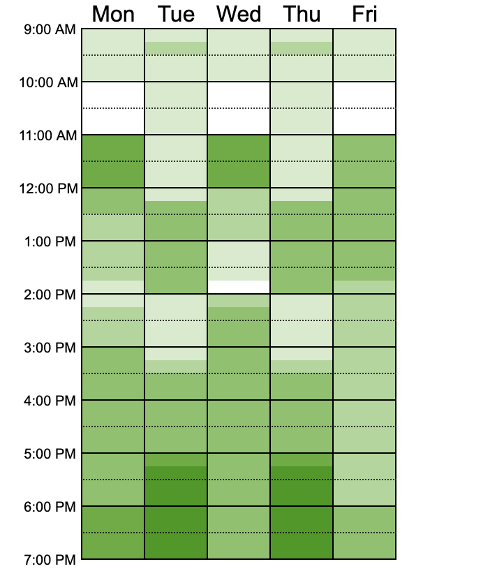

*Table or Booth Team Notebook

**Notebook entry template

Date 
Author 
Milestone 
| Type | Meeting / Design decision / Sketch / Diagram / Pseudocode / Race condition / Bug / Fix / Test (pass or fail) / Timing result / Timing anomaly / Milestone notes / Contribution |

**What happened or what we did**

**Details** 

- Attendees if its meeting
- Options considered and the decision
- Sketch, diagram, or pseudocode 
- Steps to reproduce, expected vs actual for bugs, race conditions, failed tests
- What we changed and whether it worked
- Setup and input siz + any other relevant data if tests were run

**Result or outcome**

**First team meeting

Date 10/16/2026
Author Dakota Hernandez
Milestone 
| Type | Meeting|

**What happened or what we did**
We met and split up the work for the team along with making github.

**Details** 

- Attendees: Dakota Hernandez, Jonah Beck, Jackfotenot

-Used when2meet.com to find when the team is all availible to meet in person

**Result or outcome**
| Workload | Owners |
|----------|--------|
| Workload 1: Independent Loop (LOOP) | Jack and Jonah |
| Workload 2: Dot Product (DOT) | Chase and Owen |
| Workload 3: Monte Carlo Pi (PI) | Dakota |

**Milestone 1 Module design diagram

Date 10/21/2026
Author Dakota Hernandez
Milestone 1: Design Proposal
| Type | Diagram |

**What happened
Added the proposed class/module design diagram to the Milestone 1 design proposal.

**Details** 

- Diagram of the module design  section of Milestone 1

